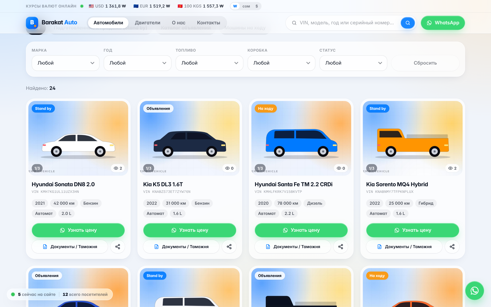
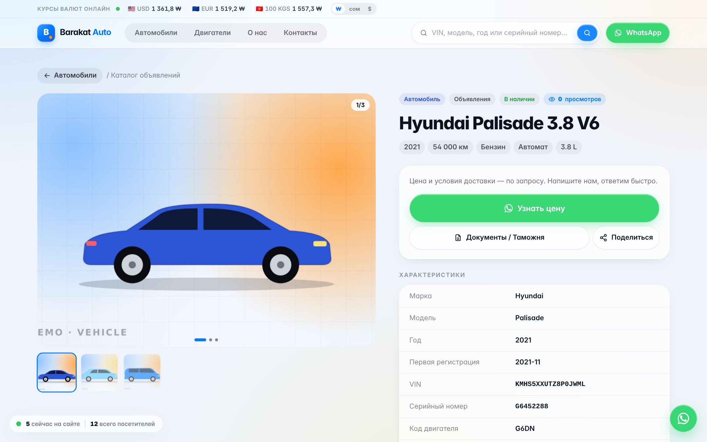
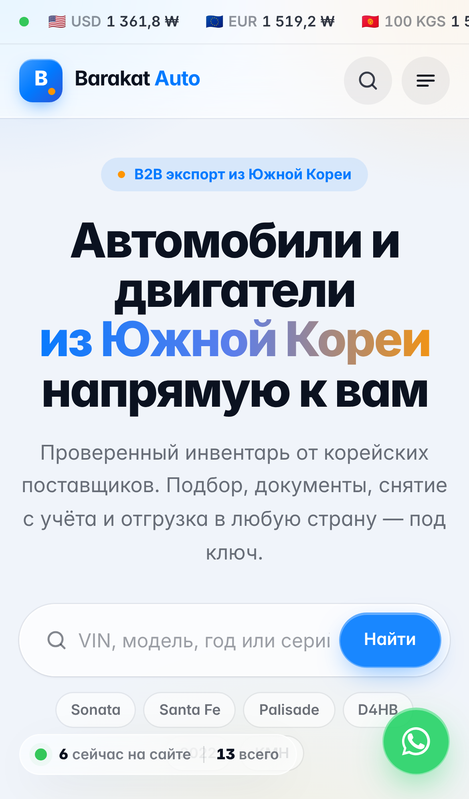
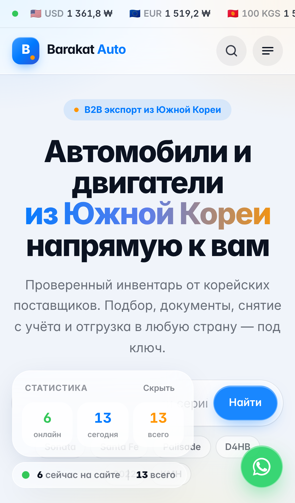
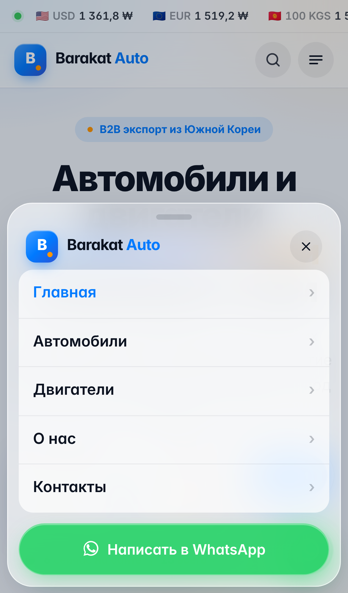
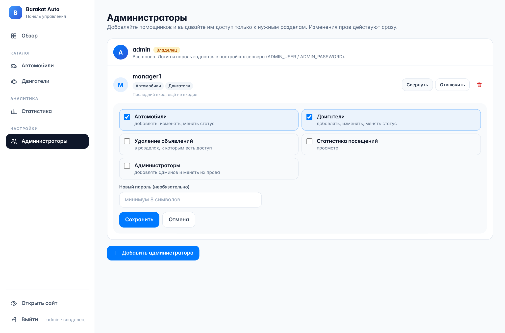

# Barakat Auto — витрина экспорта автомобилей и двигателей из Южной Кореи

B2B-сайт-витрина на 4 языках (русский, English, 한국어, 中文) + минималистичная админка.
Стек: **Next.js 15 (App Router) · React 19 · Tailwind CSS · SQLite (встроенный в Node.js `node:sqlite`, без компиляции) · sharp**. Без 3D-библиотек.

## Быстрый старт

```bash
npm install                  # нужен Node.js 22.13 или новее
cp .env.example .env.local   # задайте ADMIN_PASSWORD, SESSION_SECRET, WHATSAPP_NUMBER, SITE_URL
npm run dev                  # http://localhost:3000
```

Продакшен: `npm run build && npm start`. При первом запуске создаётся `data/app.db` и загружаются демо-данные
(24 авто — по 8 в Stand by / Объявления / На ходу, и 8 двигателей). Отключить: `SEED_DEMO=false`.
Сбросить базу к демо: `npm run db:reset`.

Админка: **/admin** (в режиме разработки по умолчанию `admin` / `admin123`).
В продакшене вход работает **только** если заданы `ADMIN_PASSWORD` и `SESSION_SECRET`.

> Хостинг: нужен Node.js-сервер с постоянным диском (VPS, Railway, Render, Fly.io и т.п.) — там лежат
> база `data/app.db` и загруженные фото `data/uploads/`. Делайте резервные копии папки `data/`.
> Serverless-платформы с эфемерной ФС (например Vercel) без внешней БД не подходят.

## Где что настраивать

| Что | Где |
| --- | --- |
| Название, email, телефон, график, адрес | `src/config/site.ts` |
| Номер WhatsApp | `WHATSAPP_NUMBER` в `.env.local` (+ `whatsappDisplay` в `site.ts`) |
| Все тексты интерфейса (4 языка) | `src/i18n/dictionaries/*.ts` |
| Тексты WhatsApp-сообщений («Узнать цену», «Документы / Таможня») | `whatsapp` в `ru.ts`, сборка — `src/lib/whatsapp.ts` |
| Цвета (стиль iOS: белый, синий, оранжевый) | `src/app/themes.css` |
| Кнопки, «стекло», анимации нажатия | `src/app/globals.css` |
| PDF-руководства покупателя | `public/guides/*.pdf` (перегенерировать: `npm run assets`, нужен Playwright) |
| Terms / Privacy | `src/app/(site)/terms`, `src/app/(site)/privacy` |

## Структура

```
src/
  app/
    (site)/              публичный сайт: главная, каталог, карточка, поиск, о нас, terms, privacy
    admin/login          вход
    admin/(panel)/       админка: обзор, [resource] (CRUD каталога), stats
    api/                 rates, visit, search/suggest, admin/*
    media/[...file]      отдача загруженных фото
  admin/                 реестр модулей админки (registry.ts) и сами модули
  components/            site / catalog / admin
  i18n/                  словари
  lib/                   db, items (репозиторий), visits, auth, uploads, whatsapp
```

### Функциональность

- **Каталог**: Автомобили (Stand by / Объявления / На ходу) и Двигатели; фильтры (марка, год, топливо, коробка, статус), пагинация.
- **Карточка**: галерея до 8 фото (свайп, миниатюры, полноэкранный режим), все характеристики, метка **SOLDOUT**, цены не показываются.
- **WhatsApp**: «Узнать цену» и «Документы / Таможня» с готовым текстом (модель, VIN, серийный номер, ссылка), «Поделиться» — WhatsApp / Facebook / Telegram / копировать ссылку.
- **Поиск** с живыми подсказками по VIN, модели, году, серийному номеру и коду двигателя; страница результатов с фильтрами.
- **Курсы валют онлайн** USD / EUR / сом (KGS) / вона (KRW) в шапке: источник Coinbase (без ключа, запасной — open.er-api.com),
  обновление каждую минуту, стрелки роста/падения, переключатель валюты отображения (₩ / сом / $).
- **Плавающее окошко**: сколько людей сейчас на сайте и сколько всего посетили (можно свернуть).
- **Просмотры объявлений**: у каждой карточки и в админке видно, сколько разных людей открыли объявление.
- **Счётчик посещений** (уникальные посетители по анонимному cookie, боты исключены): сегодня / неделя / месяц / всего — в подвале и в админке.
- **Несколько администраторов**: владелец (из .env) добавляет админов в разделе «Администраторы» и галочками выдаёт права
  (Автомобили, Двигатели, Удаление, Статистика, Администраторы). Права проверяются на сервере при каждом запросе.
- **SEO**: title/description, Open Graph и Twitter Card для каждой карточки (первое фото — превью в мессенджерах), JSON-LD, sitemap.xml, robots.txt.
  Для корректных ссылок задайте `SITE_URL`. Загруженные фото автоматически сжимаются в JPEG ≤1600px.
- **Админка**: списки с поиском и фильтрами, добавление/редактирование, удаление с подтверждением, быстрая смена статуса,
  загрузка до 8 фото с перетаскиванием для смены порядка. Изменения сразу видны на сайте и в поиске.

## Как расширять

**Новый раздел админки** (заявки, баннеры, тексты страниц, пользователи…):
1. `src/admin/modules/leads.ts` — экспортируйте `AdminModule` (`id`, `title`, `href: "/admin/leads"`, `icon`, `order`, `group`).
2. Добавьте его в массив `modules` в `src/admin/registry.ts` — пункт меню появится сам.
3. Создайте страницу `src/app/admin/(panel)/leads/page.tsx` (+ при необходимости API в `src/app/api/admin/leads`).
   Все `/admin/*` и `/api/admin/*` уже защищены `src/middleware.ts`.

**Новый тип товаров** — добавьте запись в `src/admin/modules/catalog.ts` и тип в `ITEM_TYPES` (`src/lib/types.ts`): CRUD уже готов.

**Языки интерфейса** (`src/i18n/`): русский, английский, корейский, китайский.
- Язык выбирается переключателем в шапке (🌐) или в мобильном меню и запоминается в cookie `bk_lang`;
  при первом визите — по языку браузера (казахский, кыргызский, узбекский и т. п. → русский).
- Все тексты — в `src/i18n/dictionaries/{ru,en,ko,zh}.ts` (тип `Dictionary`: TypeScript не даст пропустить ключ).
- Сообщения WhatsApp («Узнать цену», «Документы / Таможня») отправляются на языке посетителя.
- Новый язык: скопируйте `en.ts`, переведите, добавьте в `src/i18n/index.ts` и `LOCALES` в `src/i18n/config.ts`.
- Тексты объявлений (название, примечания) вводятся в админке и не переводятся автоматически. Админка — на русском.
## Скриншоты

| Главная | Каталог | Объявление |
| --- | --- | --- |
|  |  |  |

| Телефон | Онлайн-окошко | Меню | Админы и права |
| --- | --- | --- | --- |
|  |  |  |  |
